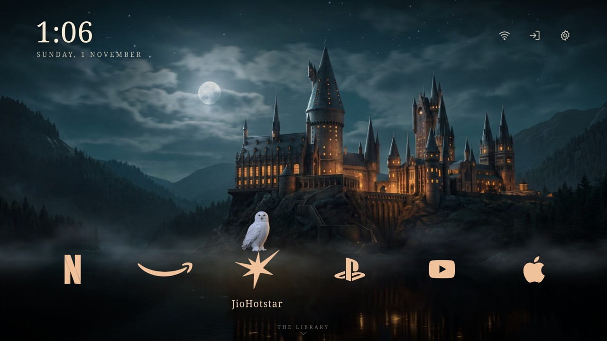
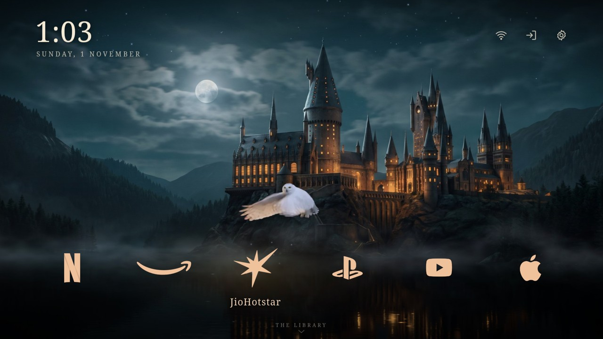
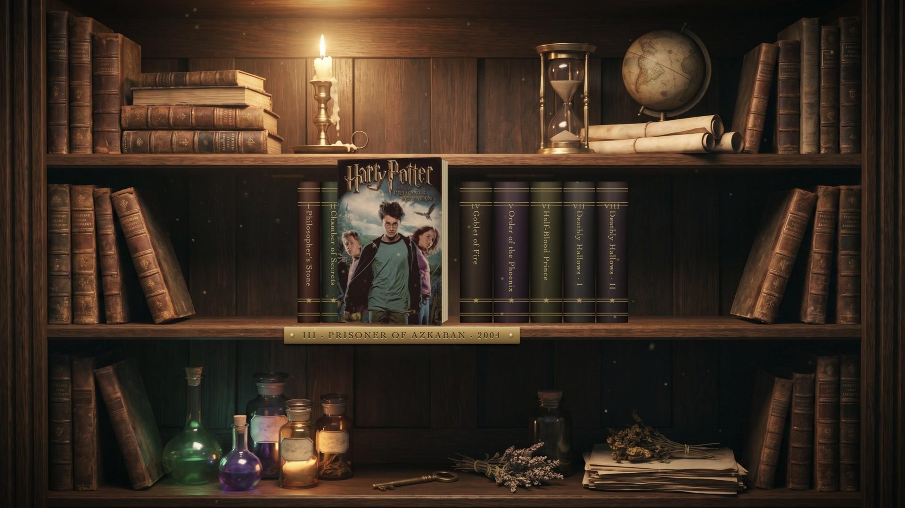
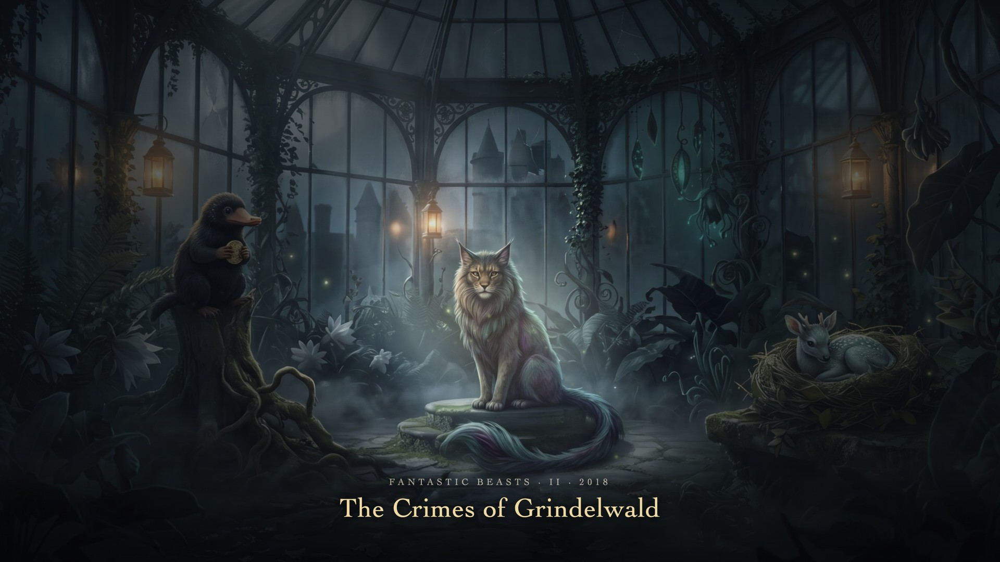
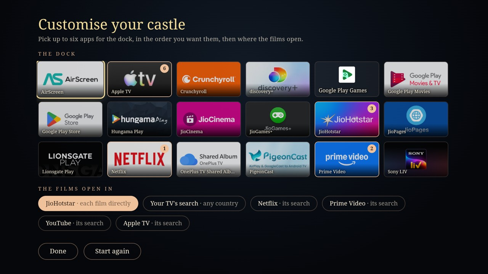

# Castle Home

A wizarding-castle home screen for Android TV and Google TV, built as its own app. A castle at night across a lake: its
windows flicker like candlelight, mist drifts over the water, the stars twinkle and the lake glints. A snowy owl perches on
the app you've selected in the dock and flies to the next one as you move. One step down is a candle-lit library where the
eight Harry Potter films are leather-bound books that turn to face you; one more is a moonlit greenhouse with a beast for
each Fantastic Beasts film, found by a soft lantern light. OK opens the film wherever you watch it.



| | |
|---|---|
|  |  |
|  |  |

Fan-made, for personal use. Not affiliated with or endorsed by Warner Bros., Wizarding World or J.K. Rowling. The book
covers are the films' posters from [TMDB](https://www.themoviedb.org), and the app logos belong to Netflix, Amazon,
JioHotstar, Sony, Google and Apple. The castle, bookshelf, greenhouse, beasts and owl were made with AI image and video
generation.

## What's here

| | |
|---|---|
| [**Castle Home.apk**](../../releases/latest) | The app, ready to install, on the Releases page. |
| [**GUIDE.md**](GUIDE.md) | The full guide: install, make it your home screen, customise it, troubleshooting, every prompt used to make the pictures, the full brief it was built from, and how to rebuild it. Also as a [PDF](docs/Castle%20Home%20-%20full%20prompt%20and%20guide.pdf). |
| [**PROMPT.md**](PROMPT.md) | A prompt for a coding assistant that asks what you watch and where, sets Castle Home up for you, builds it and installs it on your TV. |
| [**Castle Home - assets.zip**](../../releases/latest) | Every original picture and clip at full resolution, on the Releases page. |
| `hogwarts/`, `hogwarts-tv/`, `build.sh` | The source: the page, its pictures and tools, and the Android TV app. |

## Make it yours

Press **Up** on the castle to reach the gear at the top right, then **OK** (it also opens by itself the first time):

- **The dock:** up to six of your TV's apps and HDMI inputs, in the order you pick them. Netflix, Prime Video, JioHotstar,
  YouTube, Apple TV and a PlayStation get gold logos; any other app gets its name in the same candle gold.
- **Where the films open:** JioHotstar straight into each film (India), **your TV's own search** (on Google TV it lists
  where each film streams in your country), or the search of any app on your dock.

To send the films straight into another service, add its links to `hogwarts/config.js` and rebuild, or let
[PROMPT.md](PROMPT.md) find them for your country. Details in [GUIDE.md](GUIDE.md), section 6.

## Install

Castle Home needs Android 7 or newer with Android System WebView up to date. Cleaning up the TV first with
[cleanyourtv](https://github.com/Gathin23/cleanyourtv) is optional but worth it: its
[`PROMPT.md`](https://github.com/Gathin23/cleanyourtv/blob/main/PROMPT.md) switches off the ads and the stock launcher's
feeds, and everything it does can be undone.

Install the APK from [Releases](../../releases/latest) with a USB stick and a file manager, or with adb:

```bash
adb connect YOUR-TV-IP:5555
adb install "Castle Home.apk"
```

It's signed with certificate SHA-256 `71ca03bf2509b6188e931f98d0dc5eade9d73f610cc4dfeca9b299de80a97022`; check it with
`apksigner verify --print-certs "Castle Home.apk"`.

To make it the home screen on Android 10 or newer, `adb shell cmd role add-role-holder android.app.role.HOME app.tvhome.hogwarts 0`;
on Android 7 to 9, `adb shell cmd package set-home-activity app.tvhome.hogwarts/.HomeAlias`. To switch back, run the same
command with your old launcher's package, or uninstall Castle Home. More ways, and the details, in [GUIDE.md](GUIDE.md).

## The remote

| Key | On the castle | In the library | In the greenhouse |
|---|---|---|---|
| Left / Right | move along the dock (the owl follows) | browse the books | move the light between the beasts |
| Down | the library | the greenhouse | |
| Up | the gear (Customise) | back to the castle | back to the library |
| OK | open the app | open the book and the film | open the film |
| Back | | back to the castle | back to the library |
| Home | | back to the castle | back to the castle |

## What it does and doesn't do

- **No permissions.** The manifest asks for none: no internet, no accessibility service, nothing at boot. The page is a
  local file in a full-screen WebView.
- It looks up the TV's apps and HDMI inputs (for the dock and the Customise panel) and opens them with ordinary intents.
- Films open through the app you chose (its link for the film, or its search) or through the TV's own search.
- Your choices are kept by the app on the TV. Nothing leaves the TV.
- The release build offers itself as a home screen but changes nothing on its own: it's Home only once you pick it.

## Built and tested on

A OnePlus TV (C00), Android TV 10, MediaTek m7632 with 1.8 GB of memory, at 1920×1080: about 58 to 60 fps at rest and
56 while the owl hops. It should run on any Android TV or Google TV from Android 7 up; TVs with less than 1.5 GB of
memory may drop below 60 fps.

## Build it

JDK 17, the Android SDK (platform 35), Python 3 with Pillow and NumPy, and Node.js:

```bash
./build.sh            # hogwarts-tv/app/build/outputs/apk/release/app-release.apk
./build.sh install    # and install it on the TV adb is connected to
```

Preview the page in a browser with `python3 -m http.server 8765 --directory hogwarts` (arrow keys and Enter work as on
the remote; add `?tv` for the TV's rendering). Edit `hogwarts/`, not the copy in `hogwarts-tv/app/src/main/assets/www`,
which `build.sh` makes. [GUIDE.md](GUIDE.md), section 9, has the rest.

## Licence

The code is under the MIT licence (see `LICENSE`). The pictures and clips are fan art for personal use; the posters and
logos belong to their owners and aren't covered by it.
